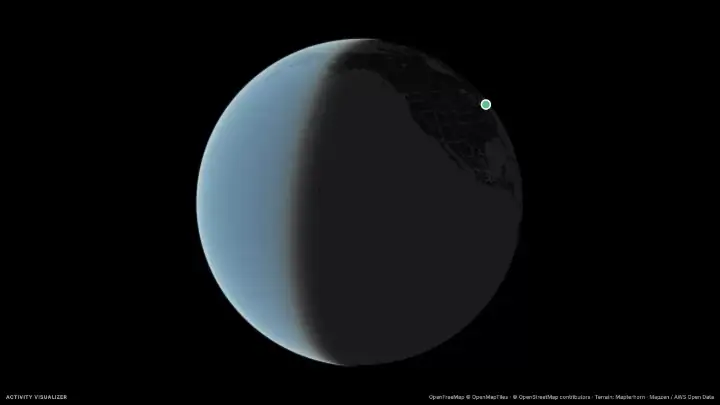

# Activity Visualizer

**[Try it live →](https://activity-visualizer.theinhumaneme.workers.dev)** · [Watch the sample flyover](https://activity-visualizer.theinhumaneme.workers.dev/?sample) · Free, no sign-up, and your files never leave your device.

[](https://activity-visualizer.theinhumaneme.workers.dev/?sample)

Upload any `.gpx` or `.tcx` activity (runs, rides, hikes, walks, skiing, paddling, swims, or anything else a GPS track can hold) from Google Health, Fitbit, Garmin, Strava and others. Check the data, dig into the analysis, watch a cinematic 3D flyover over high-resolution terrain with your photos along the way, and export a video (up to 4K) or poster. Drop several files to build a library that's remembered between visits. Files are parsed and analyzed in the browser and never uploaded.

**Steps:** Upload → Check (data audit and settings) → Overview → Analysis → Flyover → Export. Opening a file (or the sample) goes straight to the flyover, which starts playing once the first view loads; Check is optional and one click away. It opens first only when it needs an answer: a file with several activities, or a privacy zone that hides the whole route. Several files open the **Library** (heatmap, race your past selves, progress, recap). The site installs as an app.

## What it does

- **Data audit and cleaning:** format, device and timezone, sampling, channels, file vs GPS distance, moving vs elapsed time, pauses. Teleport spikes are moved back onto the track, start and finish GPS drift is pinned, HR dropouts and spikes are removed, positionless trackpoints are interpolated, and per-leg cadence is doubled. Each fix is reported.
- **Per-sport profiles** (`src/lib/sport.ts`): speed limits, moving threshold, pace or speed (pace per 100 m for swims), grade-adjusted pace only for foot sports, best-effort distances, camera distance. Unknown sports are inferred from speed and labeled as inferred.
- **Analysis:** summary, pace with GAP and a raw band, elevation colored by grade or pace with auto-labeled climbs (each with its VAM, meters climbed per hour) and the steepest 100 m, steepest 1 km and steepest descent, heart rate with zones (labeled "estimated" until you set your max), cadence, splits, best efforts, efficiency with a cardiac-drift chart and heart-rate recovery (the drop in the minute after you stop), and interval reps with HR recovery. Reps come from device laps or are detected from pace changes, and need a repeating structure so traffic stops aren't counted. Click any split, climb, rep, best effort, power-curve row or wind stretch to fly it in 3D: the flyover starts just before it and pauses just after.
- **Comparisons:** the totals on a familiar scale ("Climbed ≈ 2.4 Eiffel Towers", "Covered ≈ 3.7 Golden Gate Bridges", "Burned ≈ 2 slices of pizza" when the file has calories) on Overview and Analysis, and one on the end card or poster. Hide them on either page or on Export; the choice is remembered (`src/lib/compare.ts`).
- **Cycling power** (files with a power meter): normalized power, variability, intensity and training stress (TSS) against your FTP, work in kJ, a power chart tinted with the seven Coggan zones, time in zones, a power curve (best average power from 1 s to 5 h) whose rows highlight the effort on the map, and W′ balance (how much of your above-threshold work capacity is left, Skiba's model). Enter your FTP on the Check step (remembered), or it's estimated as 95% of your best 20 minutes; add your weight for watts per kilo and your W′ if you know it (20 kJ otherwise).
- **Weather** (opt-in): conditions, temperature, feels-like, wind, humidity and rain for the activity, from [Open-Meteo], which is sent a location rounded to about 10 km and the date. Temperature can go in the live stats and the conditions on the end card.
- **Wind:** with the weather on, headwind and tailwind along the route, from the hour's wind and your direction over each 25 m: a headwind chart, the share of moving time into, with and across the wind, and the toughest headwind and best tailwind stretches (hover to find them on the map). The live stats can show the headwind, tailwind or crosswind as you go.
- **Flyover:** establishing drop, start reveal, chase, highlights (fastest split, climbs, high point, reps, final kick), finish, pull-back, end card. The camera keeps the athlete at a fixed spot on screen, above the stats, whatever the speed; the marker's pace is smoothed so it never crawls and then races. Time compression and terrain exaggeration are shown on screen.
  - **Cameras:** Cinematic, Chase, Drone, Low, Side-on, Orbit, Overhead, or Free orbit (drag the map yourself). **Camera distance:** Auto (close for runs, rides and walks; far for hikes and everything else), Close, Medium or Far.
  - **Looks:** Night Run, Golden Hour, Editorial (with contours), Satellite, Noir, Blue Hour and Blueprint.
  - **Terrain:** high-resolution elevation from [Mapterhorn] (30 m worldwide, down to about 1 m where open lidar exists); where it has nothing finer, tiles are built from AWS terrain instead.
  - **Real sun:** terrain shading and building light come from where the sun was at the activity's place and time. On Satellite, the sky, horizon glow and imagery light follow the time of day too (greyer when the weather was overcast). **Haze:** Auto (from fog or rain in the weather), Clear, Light or Heavy.
  - **Place names:** peaks with their heights and well-known landmarks. **3D buildings** in cities (off by default on Lite).
  - **Photos:** add photos and the flyover pauses where each one was taken (placed by EXIF location, or capture time) while it fills the screen over a blurred copy of itself. Photos taken together share a stop as a collage, laid out automatically so none is cropped (up to four per page); more become a slideshow. Photos stay on the device, in memory only.
  - **Ghost race:** from the library's race, "Fly it in 3D" opens your latest run of a route with your best and previous attempts as ghosts, each labelled with how far ahead or behind it is; the finish shows the result.
  - **Map detail:** Auto, Lite, Standard or High (finer imagery and terrain), chosen from the device's memory and cores when on Auto.
  - **Route color:** solid (10 colors), pace, HR zones, heart rate, grade, elevation, cadence or progress (keys 1–8).
  - **Preview frame:** Landscape, Portrait 9:16, Feed 4:5, Square 1:1 or Cinema 21:9, framed exactly like the export (portrait by default on phones).
  - **Opening:** over the route, or **from the globe**: the video starts on the whole Earth, turns to the activity and dives down into the opening shot (about 4.5 s more).
  - **Highlights** are small labels pinned to their spot on the map; turn them off if you prefer a clean map.
- **Privacy zone** (default 200 m): hides the route near your start and finish on every map, in the flyover and in exports. Stats still use the whole activity.
- **Export:** 9:16, 4:5, 1:1, 16:9 or 21:9 MP4 at 720p, 1080p or 4K (21:9 at 4K is 3840 wide), 30 or 60 fps, plus PNG posters. Rendered frame by frame on your device (deterministic; once frames start it keeps going in a background tab, and the screen stays awake). Where the browser can share files, **Share** sends the video or poster straight to other apps. Photos can be added here too; the length estimate includes their stops.
  - **Credit:** "Activity Visualizer" in the corner and "Made with Activity Visualizer · <the site's address>" on the end card and poster, so a shared video leads back to the app. On by default; turn it off on Export (remembered). Forks show their own address.
  - **Route playback length:** 15 s, then 30 s to 5 min in 30 s steps. The default suits the activity, keeping the time-lapse around 200× or slower (2 min for a 6-hour marathon); the opening and ending add about 10 s. The page shows the resulting speed-up and an estimated file size.
  - **Stats:** choose what the live panel shows (total or moving time, distance, pace or speed, grade-adjusted pace, heart rate, elevation, grade, cadence, power; up to 6) and what the end card or poster shows (distance, total, moving and stopped time, average, grade-adjusted and best pace, elevation gain, loss and high point, average and max heart rate, 1-minute HR drop, climbing VAM, steepest 100 m, cadence, power, normalized power, work, training stress, calories, weather; up to 8). Only stats the file has are offered, and your picks are remembered.
- **Library:** drop a folder or a whole Strava bulk export (gzipped files too). Activities are kept in this browser (IndexedDB, including the original files so each can still be opened in full) and come back on your next visit. Heatmap, race your past selves in 2D (or fly it in 3D), progress, records and a yearly recap. Progress charts fitness, fatigue and form (42- and 7-day load from heart-rate TRIMP, or power TSS) and weekly time in heart-rate zones; the recap adds race predictions (Riegel, from your best efforts), daily and weekly streaks and your Eddington number; the activity list shows GAP and training load. Activities saved by an older version are re-read in the background to fill in new stats.
- **Installable app:** a web app manifest and service worker. Once installed it opens offline (maps still need a connection), opens GPX and TCX files from the file manager, and accepts them from the share sheet.

## Performance

- **Parsing, analysis and terrain sampling run in Web Workers**, so the page stays responsive with long activities. Each activity is sent to the analysis worker once; results come back with samples as transferable typed-array columns (`src/lib/analysis/columns.ts`). A dragged trim slider can't queue up stale work: a newer request replaces one still waiting.
- **Exports preload every map tile** the flight needs, render each frame as soon as its data is in (without waiting for the browser's animation frames, which phones throttle), and redraw all terrain textures in one pass per frame.
- **Lighter on low-end devices:** the Lite detail level draws maps at 1×, drops hillshade and contours, and takes terrain tiles at face value; charts and hover update at most once per frame.
- **Loading:** routes are code-split and the next step is prefetched; MapLibre, the encoder and the contour generator load only when needed; fonts are self-hosted; hashed assets are cached for a year (`public/_headers`), and React lives in its own long-lived chunk.

## Develop

```bash
npm install
npm run dev        # Vite + the Worker together (Cloudflare Vite plugin)
npm test           # parser, analysis, camera and worker tests
npm run build
npx vite preview   # the production build, served by the Worker locally
```

Real activity files go in `tests/fixtures/private/`, which is git-ignored. The public sample (`public/samples/reservoir-loop.tcx.xml`) is synthetic: an OpenStreetMap route with a borrowed pace and HR rhythm, regenerated by `node scripts/make-demo.mjs <source.tcx>`.

## Deploy (Cloudflare Workers)

```bash
npx wrangler login
npm run deploy
```

The app is static files served by Workers Static Assets (no Worker invocation), with an SPA fallback. The Worker (`worker/index.ts`) only answers `/api/health` and `/api/config` (which imagery to use and its attribution), so it stays well inside the free plan. Everything runs on the free tier: no paid services or keys.

Map tiles don't go through the Worker: the browser fetches them straight from each provider (OpenFreeMap, Esri, Mapterhorn, AWS). All of them send CORS headers, so the WebGL canvas stays readable for video export. No activity data goes anywhere; all processing happens on the device.

Satellite imagery defaults to Esri World Imagery (free, for light use). To use MapTiler instead, set a key as a secret; `/api/config` then hands the app MapTiler's tile URL. The key reaches the browser, as MapTiler keys are designed to, so restrict it to your domain in the MapTiler dashboard:

```bash
npx wrangler secret put MAPTILER_KEY
```

The 2D basemaps and flyover labels come from [OpenFreeMap](https://openfreemap.org) (free, no key). Flyover terrain comes from [Mapterhorn] with the AWS Terrain Tiles open dataset filling in; analysis elevation uses AWS terrain. Weather comes from [Open-Meteo] (free, no key).

## How the flyover and export work

`src/lib/playback/timeline.ts` is a pure function from video time to camera, marker and overlay cues. It bakes the whole camera path at 60 Hz, so live preview and export are frame-identical. `src/lib/hud/hud.ts` draws the HUD on a canvas, and the same code draws the preview overlay, every video frame and posters. Export (`src/lib/export/render.ts`) works out every tile the flight needs and preloads them, then renders each frame off-screen, waits for any missing tiles, composites the HUD, and encodes MP4 (H.264) with WebCodecs via [Mediabunny]. Browsers without WebCodecs fall back to a MediaRecorder capture that pauses while each frame renders, so the video keeps the right timing. Route playback lengths and camera distances live in `src/lib/playback/lengths.ts`; the stat catalogs in `src/lib/hud/stats.ts`. Photo stops (`src/lib/playback/photoStops.ts`) wrap a finished timeline, inserting held time at each stop so the camera path is untouched; the collage layout is in `src/lib/hud/photoLayout.ts`. The globe intro (`src/lib/playback/globeIntro.ts`) is the same kind of wrapper, prepending the dive. Ghosts are in `src/lib/playback/ghosts.ts`, the sun, sky and haze in `src/lib/map/sun.ts`, wind in `src/lib/wind.ts`.

Map styles live in `src/lib/map/style.ts`. Every provider is keyless by default (OpenFreeMap vector tiles, Esri imagery, Mapterhorn and AWS terrain), and switching provider means editing the tile URLs at the top of that file.

[Mediabunny]: https://mediabunny.dev
[Mapterhorn]: https://mapterhorn.com
[Open-Meteo]: https://open-meteo.com

## License

[MIT](LICENSE) © Kalyan Mudumby. Map data © OpenStreetMap contributors; basemaps by OpenFreeMap (OpenMapTiles); terrain from [Mapterhorn](https://mapterhorn.com/attribution) and the AWS Terrain Tiles open dataset; weather by Open-Meteo; imagery by Esri (or MapTiler with a key). Built with MapLibre GL JS, Mediabunny, React and uPlot.
